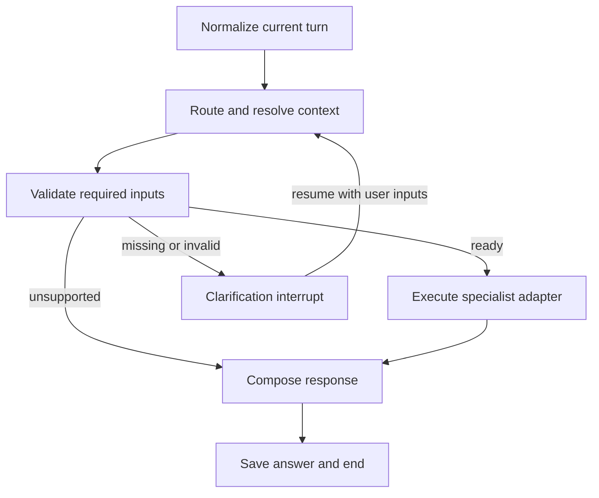

# LangGraph orchestrator implementation

The first release connects the four specialists through one conversation.
It implements phases 1–4 of [the architecture plan](orchestrator_plan.md).
One specialist executes per request; bounded portfolio-to-goals cooperation is
still phase 5. Existing specialist CLIs and calculations remain supported.

## Execution flow



`graph.py` builds a real `StateGraph`, conditional edges, `InMemorySaver`, and
`interrupt`/`Command(resume=...)`. The clarification node contains no provider or
generation work before its interrupt, so resuming it cannot repeat such calls.
Execution has a recursion limit of 16; it has no automatic agent retry loop.

Rules handle explicit routes, structured arguments, concept questions, clear
holdings/goal requests, uppercase ticker requests, and unambiguous follow-ups.
Other requests get one strict-schema OpenAI routing/extraction call. Invalid or
failed router output asks for clarification rather than executing an arbitrary
tool. The router can return only the four known agent names and limited fields.

Natural-language extraction currently supports market fields and absolute monthly
contribution/budget edits. Broader goal facts use the validated JSON input below.
This is intentionally a bounded parser, not a general autonomous planner.

## Run it

Install/refresh commands with `python -m pip install -e '.[dev]'` from the project
virtual environment. The tested dependency versions are LangGraph 1.2.19 and
langchain-core 1.7.3. The existing `.env` keys configure OpenAI and Alpha Vantage;
the Tavily placeholder remains unused.

```bash
.venv/bin/finnie-chat
.venv/bin/python -m workflow --help
.venv/bin/finnie-chat --plan src/data/sample_goals_plan.json "Analyze goals"
.venv/bin/finnie-chat --holdings src/data/sample_portfolio_holdings.csv "Analyze holdings"
.venv/bin/finnie-chat "Analyze AAPL for 20 sessions against SPY"
```

`--route chat|portfolio|market|goals` bypasses intent classification. `--arguments`
loads a JSON object of typed arguments. `--json` includes status, result artifact
IDs, and metrics. `--progress` prints graph stage events to stderr. A one-shot
command exits with 2 for missing inputs, 1 for unavailable/error, and 0 for a
completed response (inspect `result.status` for partial market data).

`--no-llm` disables both model routing and specialist generation. Q&A then shows
retrieved excerpts explicitly labeled as local excerpts. `--no-rag` skips the
index; Q&A is unavailable without evidence, while analytical agents still
calculate. Market requests still call Alpha Vantage when LLM/RAG are disabled.

Interactive commands:

| Command | Action |
|---|---|
| `/upload PATH` | Validate and register CSV/XLSX holdings; print portfolio IDs |
| `/plan PATH` | Validate and register a GoalPlan JSON; print its ID |
| `/artifacts` | List the current conversation's artifact metadata |
| `/cancel` | Cancel pending clarification and retain previous validated context |
| `/quit` | Exit; process-local conversation memory ends |

An input line starting with `{` is a JSON argument object. Model output cannot
choose local paths; paths enter through explicit CLI commands/service uploads.
Multiple uploaded portfolios or plans require a selection. Uploading one new
input selects it on the next new turn; explicit IDs override that selection.

## Multi-turn example

Start with a fully local goals conversation:

```bash
.venv/bin/finnie-chat --no-llm --no-rag --plan src/data/sample_goals_plan.json
```

Then enter these lines in order:

```text
Analyze goals
What if I contribute 1100 monthly?
{"plan_updates":{"monthly_budget":1100}}
Explain that shortfall
/quit
```

The initial projection uses the supplied assumptions. The contribution change
pauses because the shared budget is still 900. The JSON reply explicitly raises
it to 1100; validation then permits recalculation. The old plan/report remains
available as an immutable version. The explanation uses the latest saved report
without recalculation or retrieval. With `--no-llm`, this is the local summary;
with generation enabled, the follow-up question is passed to the explainer.

For richer edits, use `goal_id` when multiple goals exist:

```json
{
  "goal_id": "house",
  "goal_updates": {"target_amount": 65000, "monthly_contribution": 1100},
  "plan_updates": {"monthly_budget": 1100}
}
```

For a new plan, provide `{"plan": {...}}` with the required GoalPlan fields or
use `/plan PATH`. No growth/inflation assumption, target, date, or budget is
silently supplied. Incremental prose such as “200 more” asks for an absolute
contribution to avoid changing the wrong commitment.

For market follow-ups, “Analyze AAPL for 20 sessions against SPY” followed by
“What about MSFT?” reuses 20 sessions, SPY, and the price basis. “Explain that
drawdown” reuses the saved report. “What is drawdown?” routes to educational
Q&A. Unknown referents ask for clarification. News synthesis and trade execution
return unsupported responses.

## Service API and storage

```python
from workflow import WorkflowService, TurnRequest

service = WorkflowService()  # Keep this instance across UI reruns.
uploads = service.add_holdings("conversation-1", content, "holdings.csv")
response = service.submit("conversation-1", TurnRequest(
    message="Analyze holdings",
    arguments={"portfolio_id": uploads[0]["id"]},
))
if response.status == "needs_input":
    response = service.resume("conversation-1", {
        "message": "Use this input",
        "arguments": {"portfolio_id": uploads[0]["id"]},
    })
if response.result and response.result.report_id:
    structured_report = service.get_report("conversation-1", response.result.report_id)
```

`submit`, `resume`, `cancel`, `get_state`, `add_holdings`, `add_plan`, and
`get_report` form the UI-facing API. Use `resume` for a pending clarification;
use `cancel` before replacing it with a new request, or pass a different
explicit route to `resume`. A local lock serializes mutations on the service.

Each LangGraph thread has separate messages, selected inputs and report IDs.
Clients, credentials, Chroma objects and upload bytes stay outside checkpoint
state. Only a bounded recent conversation and selected facts go to the router.
Full report JSON remains in the artifact store, accessible through `get_report`.
Reports retain their specialist evidence, model/fallback labels and data dates.

Artifacts use opaque IDs, SHA-256 integrity checks, immutable parent/version
metadata, a 16 MB per-artifact limit, and 128 artifacts per conversation by
default. Uploaded holdings retain the existing 10 MB limit. Files live in
owner-only directories under `runtime/artifacts/`; this directory is gitignored
and separate from the knowledge base and sample data. Artifact lookups enforce
conversation ownership; a thread ID itself is not authentication.

The checkpointer, artifact registry and native report objects are process-local.
Disk JSON artifacts do not provide restart recovery. A fresh CLI process with
the same `--thread-id` does not restore the old conversation. SQLite checkpoints,
artifact reload/cleanup, cross-chat profiles, a web UI, and authentication are
outside this first release. Deleting a completed process's `runtime` files is a
manual retention operation; no automatic cleanup runs.

The subsequent [Streamlit UI](streamlit_ui.md) now provides the web interface
and explicit local user profiles. Its workflow uses `ArtifactStore(persist=False)`
for session inputs/reports, and writes only explicitly saved profile inputs to
`runtime/users/`. The CLI's default disk artifacts and process-local checkpoints
remain as described above.

## Call limits, failures, and metrics

An ordinary request has zero or one router call, at most one specialist
retrieval, and at most one specialist narrative generation. The response
composer is deterministic. Q&A with no retrieved evidence abstains without a
generation call. Clarification performs no specialist/API/narrative work.
The graph does not retry providers around their existing retry/cache behavior.

Metrics report routing method, router call attempts, routing/validation/execution
latencies, retrieval invocations, narrative generator invocations, provider
operations, saved-report reuse, and explanation model/method. A provider operation
is `get_history` or `get_quote`, which can hit cache or make internally retried
HTTP requests; it is **not an HTTP-attempt count**. Market report source metadata
preserves provider attempt counts where available. Failed initialization before
a generator call is not counted as a narrative API invocation.

Expected specialist partial/unavailable reports remain visible. Unexpected
execution errors return sanitized text and preserve earlier valid inputs.
Failure to load the knowledge index leaves analytical metrics available with a
warning. Explanation failure retains the specialist's labeled local fallback.
Unsupported requests never run a specialist. Progress callbacks receive stage
and request ID only; there are no financial payloads in progress events.

## Verification

```bash
.venv/bin/python -m unittest discover -s tests -q
.venv/bin/python -m coverage run --source=workflow,tools.openai_router -m unittest discover -s tests -q
.venv/bin/python -m coverage report -m
```

The tests include routing cases, strict router schema/refusals, invalid/resumed
inputs, local upload/goal calculations, provider and LLM failures, partial market
reports, single retrieval/generation counts, focused saved-report explanations,
immutable baselines, thread isolation, cancellation, and CLI conversations.
Coverage applies to the new workflow/router code, not an unmeasured claim about
the entire project. Routing tests use deterministic cases and mocked model
outputs; these are not a measured natural-language model accuracy benchmark.

Implementation verification: 176 tests passed; workflow/router statement
coverage was 94%. A live smoke check routed a Microsoft question through the
structured router to MSFT, fetched market data through 2026-10-30, and retrieved
knowledge once. The narrative output failed the specialist's validation and
used its labeled local fallback. A subsequent saved-report follow-up made zero
provider, retrieval, and model calls. The compact live-check results are saved
locally in gitignored `runtime/workflow_smoke.json`.

LangGraph references: [Graph API](https://docs.langchain.com/oss/python/langgraph/graph-api),
[interrupts](https://docs.langchain.com/oss/python/langgraph/interrupts),
[persistence](https://docs.langchain.com/oss/python/langgraph/persistence).
