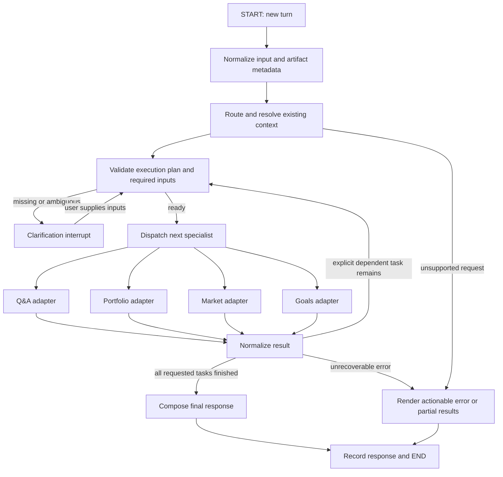

# LangGraph orchestration plan

Status: phases 1–4 are implemented in `src/workflow/`, with the conversational
CLI `finnie-chat`. See [the implementation walkthrough](orchestrator.md).
The bounded two-agent workflow in phase 5 remains a subsequent increment;
the current graph executes one specialist per request.

## Objective and scope

Connect Finnie's four working agents into one stateful conversational assistant:
finance Q&A, portfolio analysis, market analysis, and goals planning. Preserve
existing calculations, API fallbacks, retrieval limits, provenance, and standalone
CLIs. LangGraph owns coordination and state; agents retain their domain behavior.

First release: reliable single-agent routing, structured input collection,
context-aware follow-ups, conversation isolation, and a unified response. Next,
add a bounded, explicit two-agent workflow to demonstrate agent cooperation.
News synthesis and dedicated tax agents, trading, autonomous replanning loops,
and cross-chat user profiles remain outside this implementation.

## Graph



Use StateGraph with typed shared state and conditional edges. Each specialist
node is an adapter calling existing Python code, not another unrestricted agent
loop. This follows the documented custom-workflow model, in which nodes may
wrap ordinary functions or complete agents.

References:
- https://docs.langchain.com/oss/python/langgraph/graph-api
- https://docs.langchain.com/oss/python/langgraph/workflows-agents

## 1. Shared contracts

Define small Pydantic boundary contracts and a TypedDict graph state. Contracts
provide validation; reducers describe how LangGraph combines updates.

### TurnRequest

- request_id and current user message.
- Optional explicit route (from a UI tab or CLI flag).
- Uploaded artifact IDs and selected portfolio/goal IDs.
- Explicit typed field updates for a follow-up.
- Feature choices: RAG, LLM explanation, market period/benchmark/price basis.

### RouteDecision / ExecutionPlan

- tasks: one task normally, at most two for an explicitly requested composite.
- Each task: task_id, agent enum, validated arguments, artifact versions,
  dependencies, and missing fields.
- needs_clarification and a concise, targeted question when necessary.
- A decision reason for diagnostics, not hidden reasoning transcripts.
- No free-form executable tool names, shell commands, file paths, or dynamic code.

### AgentResult

- agent, task_id, request_id, and normalized status:
  success / partial / needs_input / unavailable / error.
- JSON-serializable structured report or artifact reference.
- Ready-to-display Markdown when a specialist already explained its report.
- References, data dates, input version, explanation method/model, warnings.
- Execution metrics: elapsed time and API/RAG/model call counts.

### Graph state

| Field | Purpose and lifetime |
|---|---|
| messages | Conversation messages with add_messages reducer; bounded model-facing history |
| active_context | Selected portfolio, market request, goal plan, and report IDs/versions |
| artifact_registry | Metadata and references to validated inputs/results; no raw upload bytes |
| pending_request | Typed request and missing fields while clarification is pending |
| execution_plan | Current turn's bounded task list |
| current_task | Task index; reset on every new turn |
| results | Current turn's keyed outputs; reset on every new turn |
| final_response | Current turn's response; reset before execution |
| errors / timings | Current-turn diagnostics; no credentials or raw provider exceptions |

Session identity is passed through LangGraph's configurable thread_id. API
clients, secrets, Chroma connections, and dependency instances are injected into
nodes and are not checkpointed. Structured facts are authoritative; a prior
assistant sentence must not silently become a verified balance or assumption.

Expose a common agent adapter protocol instead of forcing every existing agent
to inherit a base class. This gives the common functionality requested by the
milestones without rewriting domain classes.

## 2. Routing policy and LLM budget

Apply these steps in order:

1. Honor an explicit supported route from the UI/CLI.
2. Resolve unambiguous context actions, such as selecting an uploaded portfolio
   or changing a named field in an active goals plan.
3. Apply narrow deterministic rules to unmistakable requests.
4. Otherwise use one structured LLM routing/extraction request.
5. Validate its route and arguments in Python. Ask for missing information or
   ambiguity instead of repairing it through repeated model calls.

Rules are a fast path, not the entire natural-language classifier. A keyword
such as volatility must not automatically select the market agent.

| Request | Expected behavior |
|---|---|
| What is volatility? | Q&A |
| Analyze AAPL for 20 sessions against SPY | Market |
| Is my AAPL position too concentrated? | Portfolio; require the relevant holdings |
| Analyze this uploaded CSV | Portfolio; require selection if multiple portfolios exist |
| Can I reach my house-deposit goal? | Goals; gather required target, date, funding and assumptions |
| What if I contribute 200 more each month? | Resolve active goal; validate the contribution AND shared budget |
| What about MSFT? | Reuse market settings only when active market context is unambiguous |
| Explain that drawdown | Explain the previous report; do not refetch unless refresh is requested/needed |
| Why did the stock fall today? | Offer measured market changes and disclose that news-based causal analysis is unavailable |
| Summarize today's news | Unsupported until the news synthesizer exists |

A tax concept can use educational Q&A with appropriate document scope. Do not
pretend there is a dedicated tax calculator or current-law verification service.

Call budget:
- Explicit/rule route: zero router LLM calls.
- Model-based route: at most one router call.
- Ordinary single-agent request: its existing one answer/explanation call;
  the composer does not call another LLM.
- Clarification with unresolved fields: no specialist, market API, or answer LLM.
- Bounded multi-agent request: run analytical agents with use_llm=False, then
  make one final, grounded synthesis call over their reports. No individual
  specialist narration plus a second narration layer.
- At most one retrieval inside each executed specialist; no orchestrator RAG.

Therefore an executed request usually has one narrative LLM call plus zero or
one routing call. Preserve explicit local-only operation: deterministic routes
and local summaries, with clarification when rules cannot resolve an intent.
No automatic router retry/repair loop or graph-level retry around agents that
already retry API calls.

## 3. Agent adapters

| Adapter | Existing entry point | Adaptation required |
|---|---|---|
| Q&A | agents.chat.agent.QnAAgent.answer | Supply a context-resolved question and category. Normalize Answer and references. For future composite workflows, expose an evidence-only preparation path because answer currently always generates prose. |
| Portfolio | agents.portfolio.holdings.load_holdings; agents.portfolio.report.build_report | Resolve validated uploaded Portfolio objects; use build_report instead of the workbook-only sample selector. Normalize reports and preserve selected portfolio ID. |
| Market | agents.market.agent.MarketAnalysisAgent.analyze | Resolve ticker, sessions, benchmark, and adjusted flag. Preserve partial/unavailable status and real data dates. Reuse provider instances so their bounded caches have session/app lifetime. |
| Goals | agents.goals.agent.GoalsPlanningAgent.plan | Assemble and validate GoalPlan from explicit facts and user edits. Preserve baseline/scenario separation; never invent growth or inflation assumptions. |

Reusing conversation context requires more than storing messages. The Q&A agent
currently accepts one question; the adapter must resolve references using recent
messages/report facts before invoking it. An unexplained question like "why is
that risky?" must not be sent to vector search without its referent.

For report-focused follow-ups, add an optional user-question field to the
specialist explanation context. Re-explain the saved report and its saved
knowledge rather than rerunning analysis/retrieval; a requested refresh or an
input change follows the normal calculation path. Merely remembering an old
report without passing the follow-up question to its explainer is insufficient.

Provide one public portfolio analysis entry point if an adapter needs a pure
calculation path; avoid wiring graph code to private methods. This is a small
interface adjustment, not a calculation rewrite.

## 4. Missing information and clarification

Validate before invoking a specialist. Examples:

- Portfolio: no upload, malformed holdings, multiple portfolios without a choice.
- Market: missing ticker, ambiguous company name, unsupported sessions, adjusted
  versus raw return basis ambiguity when relevant.
- Goals: missing amount/date/currency, funding assignments, return/inflation
  assumptions, risk label, or conflicting shared-budget commitments.
- Context: multiple candidate goals or reports for "it" or "that".

Ask a concise bundled question for the missing inputs; do not collect unrelated
personal details. Never fill a return assumption from a recent market return.
UI forms can collect typed values directly and skip a routing model call.

Use interrupt() in a dedicated clarification node and resume with Command(resume=...)
under the same thread_id. Keep API/model calls outside the interrupt node:
LangGraph resumes by restarting that node, so work before an interrupt must not
cause repeated paid calls or repeated state mutations. Invalid resumed input
remains in clarification; a new intent can replace the pending request cleanly.

Reference: https://docs.langchain.com/oss/python/langgraph/interrupts

## 5. Memory, artifacts, and updates

Start with InMemorySaver and one graph thread per application conversation.
Maintain the graph/checkpointer instance across UI reruns. This supplies
conversation continuity while the process runs; it does not survive restarts.
Offer SQLite checkpoint persistence next if restart persistence is required.
Do not add a cross-chat store or authentication system for the capstone MVP.
A thread ID isolates state logically; it is not an authentication mechanism.

Keep uploads and large schedules in a local artifact store with bounded size,
content hashes, and input versions. Checkpoint references and compact facts;
pass only the relevant facts to the router/model, not entire files and all
previous report schedules. Runtime artifacts/checkpoints belong under a
Git-ignored runtime directory, not knowledge_base/documents or src/data.

Apply explicit user updates to a versioned draft and validate before committing
it. Example: increasing a goal contribution from 900 to 1100 must not silently
increase the declared 900 shared budget. Preserve old reports for comparison;
invalidate results dependent on changed input versions. Explain unchanged
reports without recalculation; refresh dated market data when requested.

Use bounded recent messages plus selected structured context. Never silently
truncate away the active goal constraints, asset assignments, or pending question.

Reference: https://docs.langchain.com/oss/python/langgraph/persistence

## 6. Explicit multi-agent cooperation

After single-agent routing is reliable, implement one bounded supported sequence:

"Analyze this portfolio, then use the amount I assign from it to evaluate my goal."

1. Portfolio agent produces a validated, dated holdings report.
2. The graph requires an explicit assigned amount and availability declaration;
   it does not treat the entire portfolio as spendable savings automatically.
3. Carry the balance source, valuation date (or unknown-date warning), currency,
   and assigned amount into the goal input; validate the shared funding ledger.
4. Goals agent projects the user-supplied funding and assumptions.
5. One final synthesis explains both reports and the assignment relationship.

Do not use current market-agent returns as forward expected returns, or replace
the portfolio agent's supplied valuations by live repricing. Those would require
additional inputs and authorization beyond the requested workflow.

Use a maximum of two explicitly requested specialist tasks initially. Execute
dependent tasks sequentially. Defer independent parallel fan-out, arbitrary
supervisor loops and dynamic agent discovery. Clearly show which agents ran.
For composite synthesis, namespace source/metric IDs by task so report-local
reference [1] cannot collide with another report's [1]. Validate the final
response references and preserve each underlying report's limitations.

## 7. Failure behavior and observability

- Invalid route/model output: deterministic clarification or explicit unavailable
  routing, not an unrelated specialist.
- Domain validation failure: targeted needs_input result; no fabricated data.
- Existing specialist partial result: preserve useful metrics and warnings.
- Market synthetic quote: preserve the market agent's exclusion from metrics.
- RAG/answer-model failure: retain existing labeled local fallbacks.
- Unexpected execution error: retain completed reports, provide an actionable
  message, and record sanitized diagnostics.
- Bound task count and graph recursion; never loop until a model invents success.
- Do not catch LangGraph interrupts as ordinary provider errors.

Track route, selected agent, request/input version, node latency, model-call
counts, retrieval counts and API attempts. No credentials or full financial
payloads in logs. External tracing is optional and off by default. Emit concise
progress events for UI/CLI: routing, needs_input, calculating, retrieving,
explaining, complete/partial.

## 8. Proposed files and dependencies

```text
src/
  workflow/
    __init__.py
    schemas.py          # TurnRequest, execution plan, AgentResult
    state.py            # Graph state and reducer rules
    router.py           # Routing policy and context resolution
    validation.py       # Required inputs, typed patches and resource checks
    adapters.py         # Existing specialist wrappers
    graph.py            # StateGraph nodes, conditional edges and compilation
    service.py          # Submit/resume/get-state API for CLI and future UI
    artifacts.py        # Local validated input/report references
    response.py         # Deterministic rendering; bounded composite synthesis
    cli.py              # Multi-turn demo without requiring a web interface
  tools/
    openai_router.py    # One structured routing/extraction API call
    openai_workflow.py  # Optional composite explanation API call
```

Add LangGraph and its required core message dependency with compatible versions
resolved at implementation time. Preserve direct OpenAI SDK clients in tools;
LangGraph does not require rewriting them into LangChain agents. Add the SQLite
checkpoint package only when implementing persistent checkpoints. No LangSmith,
news/search, brokerage, or cloud dependency is required.

## 9. Implementation sequence and acceptance gates

### Phase 1: Contracts and adapters

- Define state/request/result schemas and an adapter protocol.
- Wrap the four agents without changing their numerical behavior.
- Verify report serialization, statuses, fallback labels and provenance.

### Phase 2: Router and request resolution

- Implement explicit routes and narrow deterministic rules.
- Add one structured routing/extraction tool for remaining natural-language requests.
- Validate routes, typed arguments, input versions and missing fields.
- Create a labeled routing dataset with expected outcomes and clarification cases.

### Phase 3: LangGraph and clarification

- Build single-agent graph paths with conditional edges.
- Add InMemorySaver, thread IDs and dedicated interrupt/resume handling.
- Ensure no domain API or generation call occurs before required inputs are valid.

### Phase 4: Follow-up memory and a conversational CLI

- Reuse selected ticker/portfolio/goal context on unambiguous follow-ups.
- Apply validated patches; preserve old baselines and isolate conversations.
- Add submit/resume entry points and progress/latency events for later Streamlit use.

### Phase 5: Bounded inter-agent workflow

- Implement explicit portfolio → goals funding assignment with two adapters.
- Suppress specialist prose calls, then synthesize once over the reports.
- Validate goal-specific calculations and namespaced sources in the final answer.

### Phase 6: Verification and documentation

- All existing tests must still pass.
- Unit tests cover routing, schema failures, context resolution and stale state.
- Integration tests cover all graph paths with mocked API/LLM tools.
- Prove one final narrative call, at most one routing call, and one retrieval per
  executed specialist; clarification must not refetch data.
- Prove two thread IDs never share messages, goals, artifacts, or reports.
- Test interrupt/resume and invalid replies without duplicate calls.
- Demonstrate a multi-turn conversation that switches agents, preserves explicit
  context, and asks for missing values rather than guessing.
- Demonstrate partial market failures and LLM fallback through the graph.
- Measure workflow coverage with an 80%+ target; report routing-set accuracy and
  clarification behavior separately from unit-test coverage.
- Record representative end-to-end latency and per-node call counts.
- Update architecture/communication docs and prepare a 5–10 minute demo path.

## First implementation boundary

Implement phases 1–4 before composite workflows. This delivers a useful shared
conversation interface quickly and establishes reliable routing/state behavior.
Then phase 5 supplies explicit inter-agent cooperation for the capstone. The
existing four standalone CLIs remain supported throughout.
